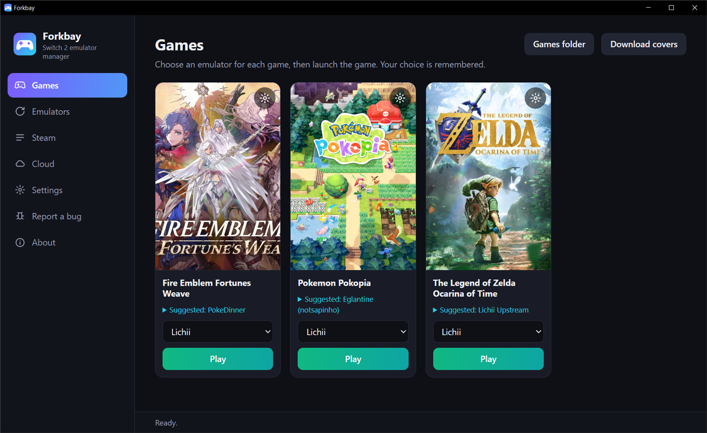
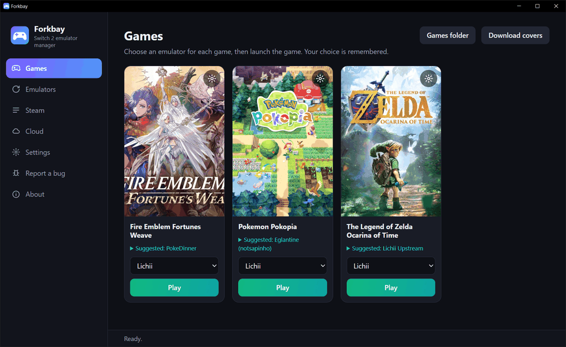
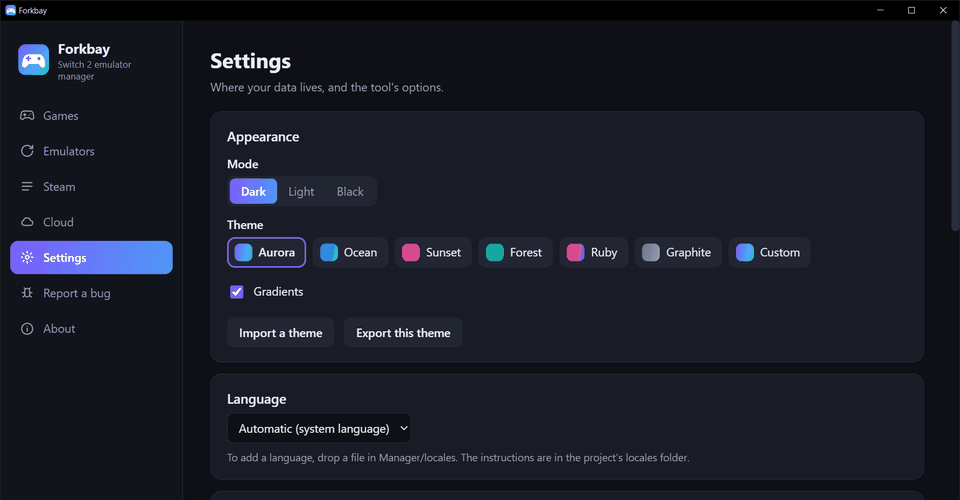
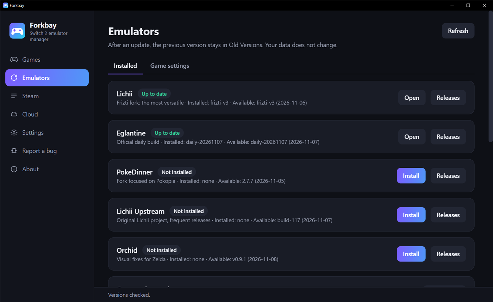
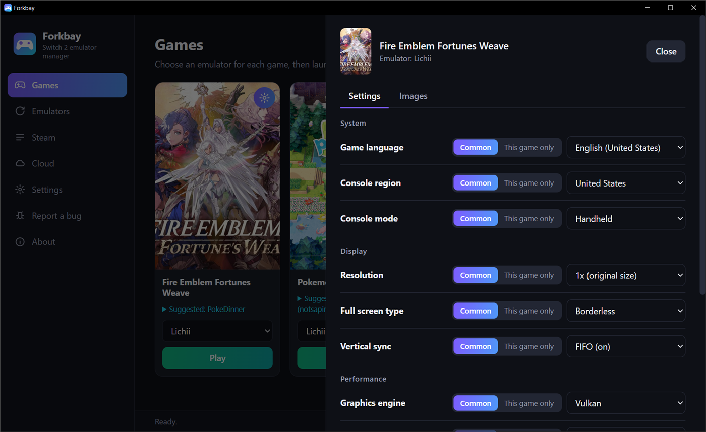
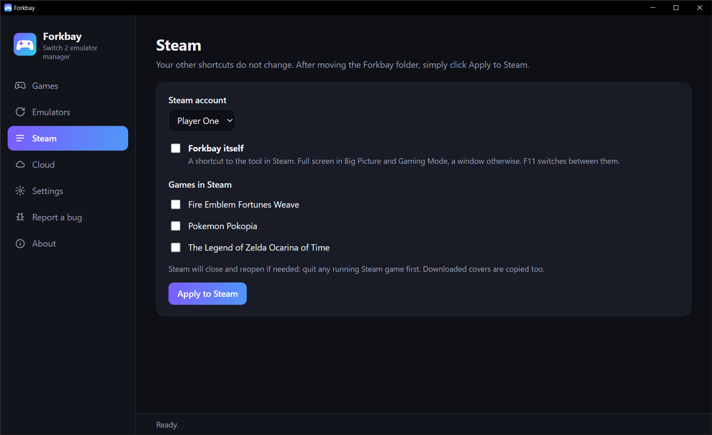
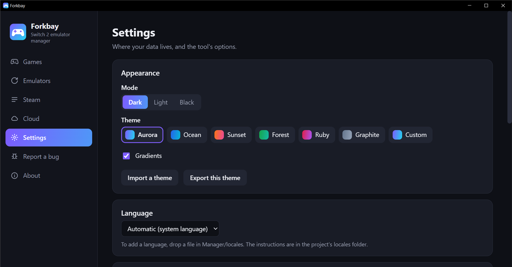

# Forkbay

**Switch 2 emulator manager**

One window for your Switch 2 emulators on Windows and Linux: launch games, keep emulators up to date, share one data folder between them, add games to Steam and sync your saves. It is a single small program, written in Rust.

**[Français](#français)**

**Each game has its own settings and images**

**Dark, light or black, with the theme of your choice**

<table>
  <tr>
    <td></td>
    <td></td>
  </tr>
  <tr>
    <td></td>
    <td></td>
  </tr>
</table>

## What it does

- **Guided setup:** imports what already exists on your PC, walks you through your keys and firmware, then installs an emulator.
- **Choose what you import:** keys, firmware, saves, profiles, controllers, network, graphics, per-game settings, mods, shader cache, screenshots, virtual SD card.
- **One data folder:** every emulator uses the same saves, keys, firmware and settings.
- **Portable or installed:** keep your data next to the tool, in your user folder, or anywhere you choose.
- **One emulator per game:** pick it once, and Steam follows your choice.
- **Updates:** compares each emulator with its latest release, shows the release notes first, and keeps the previous version so you can roll back. On Windows, downloads are also scanned with Microsoft Defender.
- **A shader cache per emulator version:** a cache left by another fork or version can give a black screen, so each one keeps its own.
- **Automatic copies:** saves, profile and settings are copied before you play and before an emulator changes version, with or without the cloud. You can restore them from **Settings**.
- **Your own emulators:** add one from a GitHub repository or from a local program.
- **Steam:** adds games to your library and leaves your other shortcuts alone.
- **Game details:** the gear on a cover opens the game's settings and images.
- **Console and picture settings:** game language, region, handheld or TV mode, resolution, vertical sync, speed limit, graphics engine and volume, on the **Emulators** page for all your games, or for one game only from its details.
- **Running games:** a game in progress shows as running, with a button to close it.
- **Per-game suggestions:** the [wichforks](https://github.com/riyadhHDA/wichforks) community guide, filtered by your graphics card. You choose; nothing changes on its own.
- **Cloud saves (optional):** syncs before and after each play session, with a choice of version when both sides changed.
- **Languages:** English and French, following your system language. [Adding one](locales/README.md) takes a single file.
- **Self-updates** from GitHub releases, with an About page for the license and links.
- **Themes:** a dark, light or black mode with a theme on top, gradients on or off, your own colors, and themes you can import and export.
- **Full screen:** games start in full screen unless you turn it off. The tool's Steam shortcut is full screen in Big Picture and Gaming Mode, and a window on the desktop. F11 switches.
- **Controller support**, and a Steam shortcut to the tool itself.
- **An error log** that leaves out paths, names and secrets.

## What you need

- Windows 10 or 11 (WebView2, included in current versions), or Linux with WebKitGTK 4.1.
- Your own keys, firmware and games, dumped from your own console. **None of them are provided here, and they must never be shared or committed.**

## Getting started

1. Run the program. It is not code-signed, so Windows SmartScreen may warn you the first time: choose **More info**, then **Run anyway**.
2. Choose where it goes: where it is now, the recommended place, or another folder. It creates a `Files` folder next to itself.
3. Follow the guided setup, and choose the folder your games (`.nup`, `.nsp`, `.xci`) are in. Nothing is moved. You can also put them in `Files/Roms`.

To build it yourself, run `cargo build --release`. On Windows, `tools/build-release.ps1` also keeps your local paths out of the program, but Defender flagged builds made this way far more often. On Linux, first install `libwebkit2gtk-4.1-dev`, `libgtk-3-dev`, `libsoup-3.0-dev` and `libjavascriptcoregtk-4.1-dev`.

## Adding an emulator

Open **Emulators**, then **Add an emulator**. For a GitHub emulator, give it a name and its `owner/repo`: the tool checks that a usable release exists. Only add sources you trust: an emulator is a program that runs on your PC. The built-in list is in `emulators.json`.

## Cloud saves

Saves, the user profile and settings are synced. **Keys and firmware are never sent.**

| Before playing | What happens |
|---|---|
| Only the cloud changed | The local version is replaced, after a backup to `Files/Save Backups` |
| Only this PC changed | The local version is uploaded |
| Both changed | You see both dates and choose, or cancel the launch |

- **Sync folder:** a Google Drive for desktop, OneDrive, Dropbox or NAS folder. No API needed.
- **Google Drive API:** create a project on [console.cloud.google.com](https://console.cloud.google.com), enable the Google Drive API, set the consent screen to External and **publish it** (otherwise the sign-in expires after 7 days), then create an OAuth client of type *Desktop app* and paste its ID and secret into the **Cloud** page. The tool only asks for the `drive.file` scope, so it only sees the files it created.

On Windows, secrets are encrypted for your account. On Linux, they stay in a settings file readable only by you.

## What goes online

There is no account, no analytics and no tracking. As with any web request, the services below can see your IP address.

- **At startup:** the tool downloads the wichforks guide from GitHub and, unless you turn off **Check at startup**, looks for a new version of itself on GitHub.
- **Emulators:** it asks each emulator's source for its latest version (GitHub or `git.eden-emu.dev`), and downloads a release when you ask it to.
- **Only if you set them up:** SteamGridDB for covers, and Google Drive for cloud saves.
- **Bug reports:** you see the full text first, and it is only sent if you submit it in your browser.

## Antivirus warnings

The program is new and not code-signed, so an antivirus can flag it by mistake, sometimes only after it has been running for a while. This has happened with Microsoft Defender. Every release is built by GitHub Actions from this repository, and its SHA-256 checksum is shown on the release page. If you are in doubt, build it yourself. Please do not disable your antivirus: report the false positive to its vendor and tell us in an issue.

## Uninstalling

1. On the **Steam** page, untick your games and the shortcut to the tool, then click **Apply to Steam**. On Windows, also delete `forkbay-launcher.exe` next to Steam's shortcut file (`userdata/<account>/config`).
2. **Copy your saves somewhere safe:** they are in your data folder, which is `Files/Data` unless you chose another location.
3. Delete the program and its `Files` folder, your data folder if it is elsewhere, and its Start menu and desktop shortcuts if you created them. Your games stay where they are.

## Limits

- **Linux:** emulators are launched from their AppImage, with their folders pointed at the shared data. Lichii by Frizti has no Linux build.
- **Moving the folder:** on Windows, Steam shortcuts find a new drive letter on their own, through a small copy of the program kept next to Steam's shortcut file (`forkbay-launcher.exe`). After any other move, open the **Steam** page and click **Apply to Steam**.
- Emulation of these games is experimental and changes daily: a newer emulator can run a game worse. The previous version stays in `Files/Old Versions`.

## Credits

This tool builds on the work of the Eden, Eglantine, Lichii, Frizti, PokeDinner and Orchid projects, the [wichforks](https://github.com/riyadhHDA/wichforks) community guide (MIT) and SteamGridDB. The licenses of the bundled libraries are in [assets/THIRD-PARTY.txt](assets/THIRD-PARTY.txt) and on the About page.

Report bugs in the tool through its **Report a bug** page. Problems inside a game should go to the emulator's own project. For security problems, see [SECURITY.md](SECURITY.md). To help, see [CONTRIBUTING.md](CONTRIBUTING.md).

This is an independent project, not affiliated with or endorsed by Nintendo. Nintendo Switch is a trademark of Nintendo.

## License

GPL-3.0-or-later. See [LICENSE](LICENSE).

---

# Français

Une seule fenêtre pour tes émulateurs Switch 2 sous Windows et Linux : lancer les jeux, garder les émulateurs à jour, partager un seul dossier de données, ajouter les jeux à Steam et synchroniser tes sauvegardes. C'est un seul petit programme, écrit en Rust.

Les captures d'écran sont [en haut de la page](#forkbay).

## Ce que fait l'outil

- **Installation guidée :** importe ce qui existe déjà sur ton PC, t'accompagne pour tes clés et ton firmware, puis installe un émulateur.
- **Tu choisis ce que tu importes :** clés, firmware, sauvegardes, profils, manettes, réseau, graphismes, réglages par jeu, mods, cache de shaders, captures d'écran, carte SD virtuelle.
- **Un seul dossier de données :** tous les émulateurs utilisent les mêmes sauvegardes, clés, firmware et réglages.
- **Portable ou installé :** tes données restent à côté de l'outil, dans ton dossier utilisateur, ou où tu veux.
- **Un émulateur par jeu :** tu le choisis une fois, et Steam suit ce choix.
- **Mises à jour :** compare chaque émulateur à sa dernière version, affiche d'abord les notes de version et garde la précédente pour pouvoir y revenir. Sous Windows, les téléchargements sont aussi analysés avec Microsoft Defender.
- **Un cache de shaders par version d'émulateur :** un cache laissé par un autre fork ou une autre version peut donner un écran noir, donc chacun garde le sien.
- **Copies automatiques :** les sauvegardes, le profil et les réglages sont copiés avant de jouer et avant qu'un émulateur change de version, avec ou sans cloud. Tu peux les restaurer depuis **Réglages**.
- **Tes propres émulateurs :** ajoutes-en un depuis un dépôt GitHub ou depuis un programme local.
- **Steam :** ajoute les jeux à ta bibliothèque sans toucher à tes autres raccourcis.
- **Fiche du jeu :** l'engrenage sur une jaquette ouvre les réglages et les images du jeu.
- **Réglages de console et d'image :** langue des jeux, région, mode portable ou TV, résolution, synchronisation verticale, limite de vitesse, moteur graphique et volume, dans la page **Émulateurs** pour tous tes jeux, ou pour un seul jeu depuis sa fiche.
- **Jeux en cours :** un jeu lancé est indiqué comme en cours, avec un bouton pour le fermer.
- **Conseils par jeu :** le guide communautaire [wichforks](https://github.com/riyadhHDA/wichforks), filtré selon ta carte graphique. C'est toi qui choisis, rien ne change tout seul.
- **Sauvegardes dans le cloud (facultatives) :** synchronise avant et après chaque partie, et te laisse choisir si les deux versions ont changé.
- **Langues :** anglais et français, selon la langue de ton système. [En ajouter une](locales/README.md) demande un seul fichier.
- **Mise à jour de l'outil lui-même** depuis les versions publiées sur GitHub, avec une page À propos pour la licence et les liens.
- **Thèmes :** un mode sombre, clair ou noir avec un thème par-dessus, dégradés activables, tes propres couleurs, et des thèmes à importer et exporter.
- **Plein écran :** les jeux démarrent en plein écran, sauf si tu le désactives. Le raccourci Steam de l'outil est en plein écran dans Big Picture et en mode Jeu, et en fenêtre sur le bureau. F11 passe de l'un à l'autre.
- **Prise en charge de la manette**, et un raccourci Steam vers l'outil lui-même.
- **Un journal d'erreurs** sans chemins, sans noms et sans secrets.

## Ce qu'il te faut

- Windows 10 ou 11 (WebView2, inclus dans les versions à jour), ou Linux avec WebKitGTK 4.1.
- Tes propres clés, firmware et jeux, extraits de ta propre console. **Aucun de ces fichiers n'est fourni ici, et il ne faut jamais les partager ni les ajouter à un dépôt.**

## Pour commencer

1. Lance le programme. Il n'est pas signé : Windows SmartScreen peut afficher un avertissement la première fois. Choisis alors **Informations complémentaires**, puis **Exécuter quand même**.
2. Choisis où le ranger : là où il est, à l'endroit conseillé ou dans un autre dossier. Il crée un dossier `Files` à côté de lui.
3. Suis l'installation guidée, et indique le dossier où se trouvent tes jeux (`.nup`, `.nsp`, `.xci`). Rien n'est déplacé. Tu peux aussi les mettre dans `Files/Roms`.

Pour le compiler toi-même : `cargo build --release`. Sous Windows, `tools/build-release.ps1` évite aussi d'inclure tes chemins locaux dans le programme, mais Defender a signalé bien plus souvent les versions compilées ainsi. Sous Linux, installe d'abord `libwebkit2gtk-4.1-dev`, `libgtk-3-dev`, `libsoup-3.0-dev` et `libjavascriptcoregtk-4.1-dev`.

## Ajouter un émulateur

Ouvre **Émulateurs**, puis **Ajouter un émulateur**. Depuis GitHub, donne-lui un nom et son `propriétaire/projet` : l'outil vérifie qu'une version utilisable existe. N'ajoute que des sources de confiance : un émulateur est un programme qui s'exécute sur ton PC. La liste fournie se trouve dans `emulators.json`.

## Sauvegardes dans le cloud

Les sauvegardes, le profil utilisateur et les réglages sont synchronisés. **Les clés et le firmware ne sont jamais envoyés.**

| Avant de jouer | Ce qui se passe |
|---|---|
| Seul le cloud a changé | La version locale est remplacée, après une copie de secours dans `Files/Save Backups` |
| Seul ce PC a changé | La version locale est envoyée |
| Les deux ont changé | Tu vois les deux dates et tu choisis, ou tu annules le lancement |

- **Dossier synchronisé :** un dossier Google Drive pour ordinateur, OneDrive, Dropbox ou NAS. Aucune API nécessaire.
- **API Google Drive :** crée un projet sur [console.cloud.google.com](https://console.cloud.google.com), active l'API Google Drive, règle l'écran de consentement sur Externe et **publie-le** (sinon la connexion expire après 7 jours), puis crée un client OAuth de type *Application de bureau* et colle son identifiant et son secret dans la page **Cloud**. L'outil demande seulement l'accès `drive.file` : il ne voit que les fichiers qu'il a créés.

Sous Windows, les secrets sont chiffrés pour ton compte. Sous Linux, ils restent dans un fichier de réglages lisible par toi seul.

## Ce qui passe par Internet

Il n'y a ni compte, ni statistiques, ni pistage. Comme pour toute requête web, les services ci-dessous peuvent voir ton adresse IP.

- **Au démarrage :** l'outil télécharge le guide wichforks depuis GitHub et, sauf si tu désactives **Vérifier au démarrage**, cherche une nouvelle version de lui-même sur GitHub.
- **Émulateurs :** il demande à la source de chaque émulateur sa dernière version (GitHub ou `git.eden-emu.dev`), et télécharge une version quand tu le lui demandes.
- **Seulement si tu les configures :** SteamGridDB pour les jaquettes, et Google Drive pour les sauvegardes dans le cloud.
- **Rapports de bug :** tu vois d'abord tout le texte, et il n'est envoyé que si tu le soumets dans ton navigateur.

## Alertes d'antivirus

Le programme est récent et n'est pas signé : un antivirus peut le signaler par erreur, parfois seulement après un moment d'utilisation. C'est déjà arrivé avec Microsoft Defender. Chaque version est compilée par GitHub Actions depuis ce dépôt, et sa somme de contrôle SHA-256 est affichée sur la page de la version. En cas de doute, compile-le toi-même. Ne désactive pas ton antivirus : signale la fausse alerte à son éditeur et préviens-nous dans un ticket.

## Désinstaller

1. Sur la page **Steam**, décoche tes jeux et le raccourci vers l'outil, puis clique sur **Enregistrer dans Steam**. Sous Windows, supprime aussi `forkbay-launcher.exe`, à côté du fichier de raccourcis de Steam (`userdata/<compte>/config`).
2. **Mets tes sauvegardes en lieu sûr :** elles sont dans ton dossier de données, `Files/Data` sauf si tu as choisi un autre emplacement.
3. Supprime le programme et son dossier `Files`, ton dossier de données s'il est ailleurs, et ses raccourcis du menu Démarrer et du Bureau si tu les as créés. Tes jeux restent où ils sont.

## Limites

- **Linux :** les émulateurs sont lancés depuis leur AppImage, avec leurs dossiers redirigés vers les données partagées. Lichii par Frizti n'a pas de version Linux.
- **Déplacer le dossier :** sous Windows, les raccourcis Steam retrouvent seuls une nouvelle lettre de disque, grâce à une petite copie du programme gardée à côté du fichier de raccourcis de Steam (`forkbay-launcher.exe`). Après tout autre déplacement, ouvre la page **Steam** et clique sur **Enregistrer dans Steam**.
- L'émulation de ces jeux est expérimentale et change chaque jour : un émulateur plus récent peut moins bien faire tourner un jeu. La version précédente reste dans `Files/Old Versions`.

## Remerciements

Cet outil repose sur le travail des projets Eden, Eglantine, Lichii, Frizti, PokeDinner et Orchid, du guide communautaire [wichforks](https://github.com/riyadhHDA/wichforks) (MIT) et de SteamGridDB. Les licences des bibliothèques incluses sont dans [assets/THIRD-PARTY.txt](assets/THIRD-PARTY.txt) et sur la page À propos.

Les bugs de l'outil se signalent ici, via sa page **Signaler un bug**. Les problèmes dans un jeu concernent le projet de l'émulateur. Pour les problèmes de sécurité, consulte [SECURITY.md](SECURITY.md). Pour participer, consulte [CONTRIBUTING.md](CONTRIBUTING.md).

Ce projet est indépendant : il n'est ni affilié à Nintendo, ni approuvé par Nintendo. Nintendo Switch est une marque de Nintendo.

## Licence

GPL-3.0-or-later. Voir [LICENSE](LICENSE).
